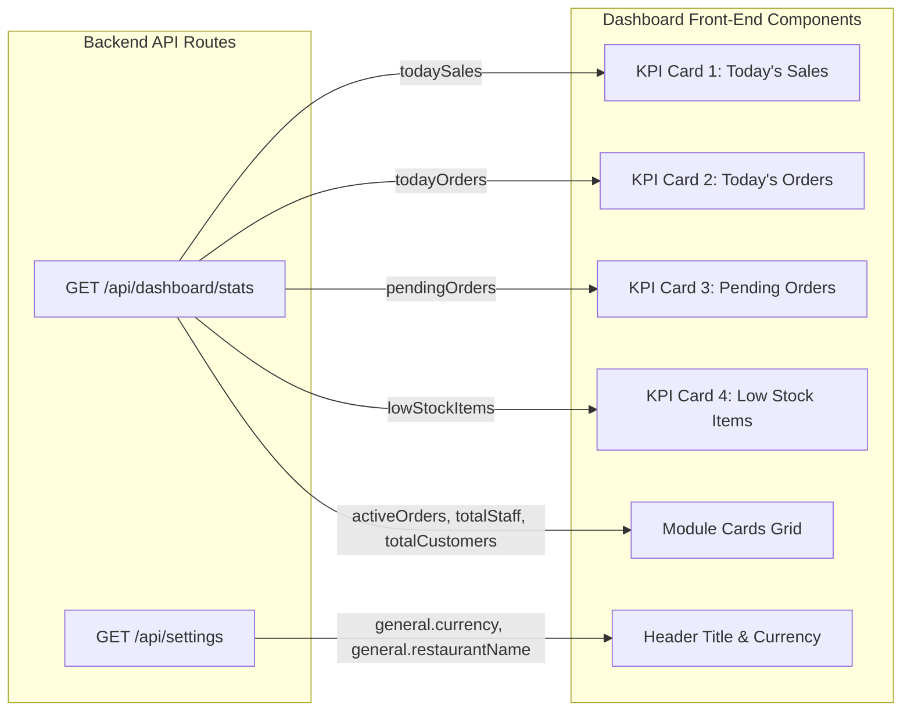

# Dashboard Data Architecture & Endpoint Mapping (DATA-MAP.md)

> **Document Classification:** Data Dependency Map, Contract Specification & Permission Matrix  
> **Status:** Phase 0 Baseline  
> **Associated Route:** `http://localhost:3000/` (POS Dashboard)  

---

## 1. Existing Endpoint/Field → Widget/Label Mapping

The primary administrative dashboard relies on two primary data streams on initial load:

### Detailed Field Mapping Table

| Endpoint | Returned JSON Field | Target Component / UI Widget | Label in UI | Formatting / Transform |
| :--- | :--- | :--- | :--- | :--- |
| `GET /api/dashboard/stats` | `todaySales` | `app/page.js` (Summary Card 1) | **"Today's Sales"** | Formatted as currency (`₹` / `$` prefix + `.toFixed(2)` or integer) |
| `GET /api/dashboard/stats` | `todayOrders` | `app/page.js` (Summary Card 2) | **"Today's Orders"** | Integer count of non-cancelled orders created today |
| `GET /api/dashboard/stats` | `pendingOrders` | `app/page.js` (Summary Card 3) | **"Pending Orders"** | Integer count of orders with status `pending` |
| `GET /api/dashboard/stats` | `lowStockItems` | `app/page.js` (Summary Card 4) | **"Low Stock Items"** | Count of inventory where `currentStock < minStock` |
| `GET /api/dashboard/stats` | `todayRevenue` | Backend aggregate | *Available in API* | Identical to todaySales; ready for multi-outlet split |
| `GET /api/dashboard/stats` | `activeOrders` | Backend aggregate | *Available in API* | Orders in `pending`, `preparing`, or `ready` state |
| `GET /api/dashboard/stats` | `totalMenuItems` | Backend count | *Available in API* | Total menu items where `available: true` |
| `GET /api/dashboard/stats` | `totalCustomers` | Backend count | *Available in API* | Active registered guest count |
| `GET /api/dashboard/stats` | `totalStaff` | Backend count | *Available in API* | Active staff records |
| `GET /api/dashboard/stats` | `pendingExpenses`| Backend count | *Available in API* | Expenses awaiting cashier/manager approval |
| `GET /api/settings` | `general.restaurantName` | Header & Title | **"Hotel-POS"** | Primary brand identifier fallback |
| `GET /api/settings` | `general.currency` | All financial numbers | Currency symbol | Defaults to `INR` (`₹`) or `USD` (`$`) |
| `GET /api/settings` | `general.email` | Header & contact pill | Official contact email | Displays admin support email |

---

## 2. Unavailable Fields & Future Metrics

The following metrics are commonly expected in modern executive dashboards but are currently not computed or returned by `/api/dashboard/stats`:

| Missing / Desired Metric | Business Requirement | Proposed Calculation / Source |
| :--- | :--- | :--- |
| **Sales Growth % (Delta vs Yesterday)** | Compare today's revenue to previous day | Requires `yesterdaySales` aggregate: `((today - yesterday) / yesterday) * 100` |
| **Average Order Value (AOV)** | Understand ticket size trends | Calculation: `todaySales / todayOrders` |
| **Category Breakdown** | Contribution of Food vs Beverage vs Bar | Requires `$group: { _id: "$items.category", revenue: { $sum: ... } }` |
| **Table Occupancy Rate** | Real-time floor plan utilization percentage | Calculation: `(occupiedTables / totalTables) * 100` from `db.collection("tables")` |
| **Peak Hour Indicator** | Highlight busiest service window | Aggregation of orders grouped by hour of day |

---

## 3. Permissions Matrix & Role Visibility

Card access is filtered dynamically in [components/DashboardCards.js](file:///Users/ideaind/Desktop/hotel-pos-system-main/components/DashboardCards.js) against the logged-in user permissions defined in [lib/rbac.js](file:///Users/ideaind/Desktop/hotel-pos-system-main/lib/rbac.js).

| Module Card | Route Target | Required Permission(s) | SuperAdmin | Manager | Cashier | Chef | Waiter |
| :--- | :--- | :--- | :---: | :---: | :---: | :---: | :---: |
| **Order Management** | `/orders` | `["view_orders", "edit_orders", "add_orders", "manage_orders"]` | ✅ | ✅ | ✅ | ❌ | ✅ |
| **Menu Management** | `/menu` | `["view_menu", "add_menu", "edit_menu", "delete_menu", "manage_menu"]` | ✅ | ✅ | ❌ | ✅ | ✅ |
| **Inventory** | `/inventory` | `["view_inventory", "add_inventory", "edit_inventory", "delete_inventory", "manage_inventory"]` | ✅ | ✅ | ❌ | ❌ | ❌ |
| **Staff Management** | `/staff` | `["view_staff", "add_staff", "edit_staff", "delete_staff", "manage_staff"]` | ✅ | ✅ | ❌ | ❌ | ❌ |
| **Reports** | `/reports` | `"view_reports"` | ✅ | ✅ | ✅ | ❌ | ❌ |
| **Settings** | `/settings` | `["manage_settings", "edit_settings"]` | ✅ | ✅ | ❌ | ❌ | ❌ |
| **Customers** | `/customers` | `["view_customer", "add_customer", "edit_customer", "delete_customer", "manage_customer"]` | ✅ | ✅ | ❌ | ❌ | ❌ |
| **Analysis** | `/analysis` | `["view_analysis", "manage_analysis"]` | ✅ | ✅ | ❌ | ❌ | ❌ |
| **Table Management** | `/admin/tables` | `["view_table", "add_table", "edit_table", "delete_table", "manage_table"]` | ✅ | ✅ | ❌ | ❌ | ❌ |
| **Kitchen Display** | `/kitchen-display` | `"kitchen_display"` | ✅ | ✅ | ❌ | ✅ | ❌ |
| **Bills & Billing** | `/bills` | `"view_bill"` | ✅ | ✅ | ✅ | ❌ | ❌ |
| **Categories** | `/categories` | `["view_category", "add_category", "edit_category", "delete_category", "manage_category"]` | ✅ | ✅ | ❌ | ❌ | ❌ |
| **Feedback QR** | `/feedback-qr` | `"manage_feedback"` | ✅ | ❌ | ❌ | ❌ | ❌ |

---

## 4. Data Quality & Runtime Caveats

1. **Numeric Type Coercion in MongoDB:**
   - Order items and totals may occasionally be saved as strings or numbers depending on input origin (e.g. `"1470"` vs `1470`).
   - All backend aggregations must use `{ $toDouble: "$totalAmount" }` to prevent silent `NaN` or zero sum calculations.
2. **Timezone Boundary Consistency:**
   - Today's date boundary is established with `const today = new Date(); today.setHours(0, 0, 0, 0);`.
   - On international or multi-outlet deployments, the timezone must be matched against `settings.general.timezone` (`Asia/Kolkata`) rather than server UTC runtime.
3. **Low Stock Comparison:**
   - The expression `{ $expr: { $lt: [{ $toDouble: "$currentStock" }, { $toDouble: "$minStock" }] } }` correctly filters only items where physical stock has fallen below threshold.
