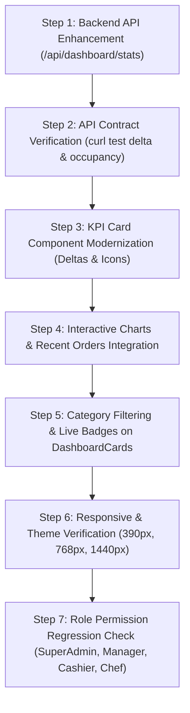

# Dashboard Redesign Implementation Plan (PLAN.md)

> **Document Classification:** Engineering Plan, File-by-File Change Strategy & Verification Sequence  
> **Status:** Draft / Phase 0 Hand-off to Phase 1  
> **Scope:** Main POS Administrative Dashboard (`/`) Redesign  

---

## 1. File-by-File Change Matrix

The following table maps every proposed file modification, rationale, dependency chain, and risk mitigation strategy:

| File Path | Component / Layer | Proposed Enhancements in Next Phases | Risk Level |
| :--- | :--- | :--- | :--- |
| [app/page.js](file:///Users/ideaind/Desktop/hotel-pos-system-main/app/page.js) | Main Dashboard Controller | - Integrate real-time delta indicators (+% vs yesterday) into KPI cards - Add modern collapsible layout container with responsive sidebar - Embed interactive sales chart widget (Recharts) directly on main page - Add quick KDS live status ticker and quick table preview | Medium |
| [components/DashboardCards.js](file:///Users/ideaind/Desktop/hotel-pos-system-main/components/DashboardCards.js) | Module Cards Grid | - Add category filter tabs (All, Operations, Culinary, Management, Analytics, Finance) - Improve card badges with real-time counters (e.g. "2 active" on Orders, "1 alert" on Inventory) - Preserve luxury frosted glass and glowing border micro-animations | Low |
| [app/api/dashboard/stats/route.js](file:///Users/ideaind/Desktop/hotel-pos-system-main/app/api/dashboard/stats/route.js) | Dashboard Analytics API | - Add yesterday sales aggregate to calculate revenue % delta - Add table occupancy metrics (`totalTables`, `occupiedTables`, `occupancyRate`) - Add average order value (AOV) field | Low |
| [components/AdminHeader.js](file:///Users/ideaind/Desktop/hotel-pos-system-main/components/AdminHeader.js) | Admin Navigation Bar | - Add light/dark theme switch toggle button - Add quick notification bell icon with badge - Add active route highlight | Low |
| [components/AccentButton.jsx](file:///Users/ideaind/Desktop/hotel-pos-system-main/components/AccentButton.jsx) | Reusable Action Button | - Support variant tokens (`primary`, `secondary`, `outline`, `danger`) - Ensure icon slot support and accessible ARIA attributes | Low |
| `components/dashboard/SalesChartWidget.js` *(New)* | Visual Analytics Widget | - High-performance interactive revenue area chart with day/week/month filter - Uses Recharts (already in dependencies) | Low |
| `components/dashboard/RecentOrdersTable.js` *(New)* | Actionable Orders Ticker | - Mini stream of the 5 most recent live orders with instant status change and reprint shortcuts | Low |

---

## 2. Verification & Testing Sequence

To ensure zero regressions across front-of-house and back-of-house operations, changes must be verified in the following sequential order:

### Detailed Verification Steps

1. **API Contract Verification:**
   - Execute: `curl -s http://localhost:3000/api/dashboard/stats | jq`
   - Verify fields: `todaySales`, `yesterdaySales`, `salesDelta`, `todayOrders`, `pendingOrders`, `lowStockItems`, `tableOccupancy`.
2. **Component Visual Rendering:**
   - Verify desktop viewport (`1280x800` and `1440x900`): Ensure all 4 KPI cards, charts, and 4-column module grid align without horizontal scroll.
   - Verify mobile viewport (`390x844`): Ensure summary cards stack 2x2 or 1x1, quick action buttons fit without text clipping.
3. **Motion & Interaction Audit:**
   - Hover over module cards: Verify 200ms ease-out elevation and shimmer sweep.
   - Click buttons: Verify `active:scale-95` tactile response.
4. **RBAC & Permission Isolation:**
   - Log in as `Manager`: Confirm access to Management and Culinary cards.
   - Log in as `Cashier`: Confirm restricted view showing only Orders, Reports, and Bills.
   - Log in as `Chef`: Confirm Kitchen Display card only.
5. **No Regressions on Core Routes:**
   - Verify navigation to `/orders/new`, `/admin/tables`, `/kitchen-display`, `/bills`.

---

## 3. Rollback & Safety Strategy

- Every modification will be scoped exclusively to dashboard components and APIs.
- Existing functions and fallback values will remain preserved.
- If any UI error or hydration mismatch occurs, the exact pre-change implementation logged in [BASELINE.md](file:///Users/ideaind/Desktop/hotel-pos-system-main/BASELINE.md) will be restored immediately.
