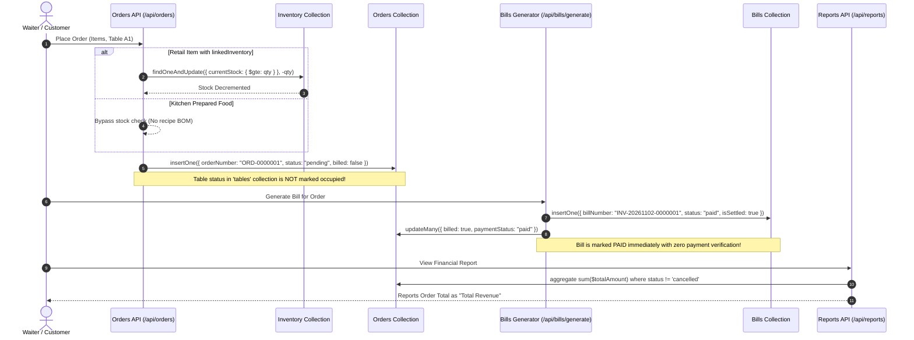

# Hotel POS — Phase 0 Repository Financial & Technical Audit

**Audit Date:** 2 November 2026  
**Auditor:** Senior Software Architect & Financial Systems Auditor  
**Scope:** Complete Codebase Inspection (Application Code Frozen / Read-Only)  
**Deliverable:** `docs/finance-upgrade/AUDIT.md`

---

## 1. Executive Summary & Verification Methodology

A comprehensive static and runtime audit of the `hotel-pos-system-main` repository was performed on 2 November 2026. Every route, data model, API endpoint, security check, print component, and calculation routine was verified against real file-level code.

### Summary Assessment
- **Operational POS Workflows:** The system possesses functional order creation, basic menu management, and a newly implemented Ambrel-style dashboard shell.
- **Financial Architecture:** Currently severely deficient for enterprise accounting. "Revenue" is measured by summing gross order amounts regardless of payment status. Generated bills immediately set `status: "paid"` without a verifiable payment transaction or receipt ledger.
- **Critical Security Defect:** Staff and SuperAdmin passwords are stored in plaintext in MongoDB, returned unredacted via `GET /api/staff`, and rendered on screen in the staff management UI for SuperAdmin users.
- **Code Integrity & Clones:** Significant copy-paste bugs exist in `/api/debtors`, `/api/expenses`, `/api/taxes`, and `/api/purchases`, where staff permission-assignment logic was mistakenly pasted into entity creation handlers.
- **Print Engine:** An orphaned 1568-line component (`components/BillPrintModal.js`) exists that actually houses an `OrderEntry` component, while the live billing page (`app/bills/page.js`) constructs an inline HTML string injected into a hidden iframe.
- **Design Baseline:** The Ambrel-style restaurant dashboard (`app/page.js`, `components/dashboard/`, `lib/dashboard/`) is present, modern, and must be strictly preserved.

---

## 2. Feature Verification Matrix

Status Labels:
- `VERIFIED`: Proven to exist in active code with verified file paths, exported symbols, and behaviors.
- `DOCUMENTED-UNVERIFIED`: Described in prompt/docs or partial comments, but inactive or unreferenced in production code.
- `PROPOSED`: Necessary feature required for standard financial systems, currently absent.
- `BLOCKED`: Dependency or prerequisites currently unavailable in this environment.

| Component / Subsystem | Current Status | Key Files / Symbol Evidence | Defect / Findings Summary |
|---|---|---|---|
| **Runtime & Framework** | `VERIFIED` | [package.json](file:///Users/ideaind/Desktop/hotel-pos-system-main/package.json), [next.config.mjs](file:///Users/ideaind/Desktop/hotel-pos-system-main/next.config.mjs) | Next.js 16.1.1, React 19.2.3, Tailwind 3.4.17, native MongoDB driver. `ignoreBuildErrors: true` set in Next config. |
| **Authentication & RBAC** | `VERIFIED` (Vulnerable) | [lib/auth.js](file:///Users/ideaind/Desktop/hotel-pos-system-main/lib/auth.js), [lib/rbac.js](file:///Users/ideaind/Desktop/hotel-pos-system-main/lib/rbac.js), [app/api/auth/login/route.js](file:///Users/ideaind/Desktop/hotel-pos-system-main/app/api/auth/login/route.js) | JWT HS256 auth exists. Plaintext password comparisons; fallback superadmin credentials hardcoded. |
| **Password Redaction** | `VERIFIED` (Critical Leak) | [app/api/staff/route.js](file:///Users/ideaind/Desktop/hotel-pos-system-main/app/api/staff/route.js#L46), [app/staff/page.js](file:///Users/ideaind/Desktop/hotel-pos-system-main/app/staff/page.js#L658-L661) | Passwords stored plaintext. `GET /api/staff` returns all password fields. SuperAdmin table renders passwords directly in plaintext. |
| **Order Placement (POS)** | `VERIFIED` | [app/api/orders/route.js](file:///Users/ideaind/Desktop/hotel-pos-system-main/app/api/orders/route.js#L463-L570) | Generates `ORD-XXXXXXX` via atomic counter. Inserts into `orders`. Table status is NOT updated. |
| **Order Placement (QR)** | `VERIFIED` | [app/api/orders/route.js](file:///Users/ideaind/Desktop/hotel-pos-system-main/app/api/orders/route.js#L326-L459) | Dry-run validation flow exists. Decrements stock for retail items upon confirmation. |
| **Bill Generation** | `VERIFIED` (Defective) | [app/api/bills/generate/route.js](file:///Users/ideaind/Desktop/hotel-pos-system-main/app/api/bills/generate/route.js#L8-L157) | Generates `INV-YYYYMMDD-XXXXXXX`. Sets `status: "paid"`, `isSettled: true`, `billPay: true` immediately without payment. Floating point rounding. |
| **Bill Printing** | `VERIFIED` | [app/bills/page.js](file:///Users/ideaind/Desktop/hotel-pos-system-main/app/bills/page.js#L581-L865) | Iframe-based print execution. Thermal 80mm & A4 CSS layouts. Orphaned `components/BillPrintModal.js` contains `OrderEntry` instead of print modal. |
| **Payment Receipts** | `DOCUMENTED-UNVERIFIED` | [app/api/settlements/route.js](file:///Users/ideaind/Desktop/hotel-pos-system-main/app/api/settlements/route.js#L160-L241) | `/api/settlements` expects `bill.status: "unpaid"`. Since `/api/bills/generate` sets `status: "paid"`, settlements route fails. |
| **Split Tender & Partial Pay** | `PROPOSED` | None | No support for multiple payments on a single bill or allocation of partial payments. |
| **Discounts** | `VERIFIED` (Uncontrolled) | [app/api/bills/generate/route.js](file:///Users/ideaind/Desktop/hotel-pos-system-main/app/api/bills/generate/route.js#L91-L103) | Reads `order.discount` without server-side approval check, manager authorization threshold, or tax recalculation. |
| **Credit Notes & Refunds** | `PROPOSED` | None | Zero credit note documents, reversal tracking, or refund logging in the codebase. |
| **Cash Drawer & Shifts** | `PROPOSED` | None | Zero register sessions, float records, cash counts, drops, or shift variance tracking. |
| **Debtors & Receivables** | `VERIFIED` (Buggy) | [app/api/debtors/route.js](file:///Users/ideaind/Desktop/hotel-pos-system-main/app/api/debtors/route.js) | Standalone debtor collection. POST endpoint contains copy-pasted staff permission validation. Not tied to invoices or aging. |
| **Expenses & Payables** | `VERIFIED` (Isolated) | [app/api/expenses/route.js](file:///Users/ideaind/Desktop/hotel-pos-system-main/app/api/expenses/route.js), [app/api/purchases/route.js](file:///Users/ideaind/Desktop/hotel-pos-system-main/app/api/purchases/route.js) | Standalone expenses & purchase line items. POST endpoints contain copy-pasted staff validation bugs. No vendor bills or 3-way match. |
| **Tax Setup** | `VERIFIED` (Buggy) | [app/api/taxes/route.js](file:///Users/ideaind/Desktop/hotel-pos-system-main/app/api/taxes/route.js) | Taxes collection exists. POST contains copy-pasted staff permission checks. Order calculation uses hardcoded/fallback 5% GST logic. |
| **Reports & Sales Totals** | `VERIFIED` (Misleading) | [app/api/reports/route.js](file:///Users/ideaind/Desktop/hotel-pos-system-main/app/api/reports/route.js#L64-L83) | Sums unverified `orders.totalAmount` as "Revenue". Ignores whether order was billed, paid, or cancelled post-delivery. |
| **Dashboard Stats & Charts** | `VERIFIED` (Buggy) | [app/api/dashboard/stats/route.js](file:///Users/ideaind/Desktop/hotel-pos-system-main/app/api/dashboard/stats/route.js), [app/api/dashboard/charts/route.js](file:///Users/ideaind/Desktop/hotel-pos-system-main/app/api/dashboard/charts/route.js#L42-L76) | Sums order totals. Category sales and top items lookup `items.menuId` which does not exist on order items, returning empty datasets. |
| **Inventory Depletion** | `VERIFIED` (Partial) | [app/api/orders/route.js](file:///Users/ideaind/Desktop/hotel-pos-system-main/app/api/orders/route.js#L328-L345, #L468-L503) | Only retail items with `linkedInventory` deplete stock. Kitchen food items have no recipe BOM depletion. No cancellation restock. |
| **Table Release** | `VERIFIED` (Defective) | [app/api/orders/[id]/route.js](file:///Users/ideaind/Desktop/hotel-pos-system-main/app/api/orders/[id]/route.js#L285-L300) | Order update emits SSE event but does NOT update `tables` document. Table release logic was abandoned in unreferenced `.new`/`.updated` files. |
| **Dashboard Design Shell** | `VERIFIED` (Authoritative) | [components/dashboard/dashboard.module.css](file:///Users/ideaind/Desktop/hotel-pos-system-main/components/dashboard/dashboard.module.css), [app/page.js](file:///Users/ideaind/Desktop/hotel-pos-system-main/app/page.js) | Ambrel-style theme with Urbanist typography, scoped `--dash-*` tokens, clay/sage/sand/sky pastel cards. |
| **Odoo Integration** | `BLOCKED` / `NOT REQUESTED` | None | No Odoo credentials, sandbox instance, version, or accounting ownership configured. |

---

## 3. Detailed Symbol-Level Evidence & Technical Findings

### 3.1 Tech Stack & Environment Baseline
- **Next.js & React:** `next: "^16.1.1"`, `react: "^19.2.3"`, `tailwindcss: "^3.4.17"`.
- **Database Driver:** Native `mongodb: "latest"`.
- **Environment (.env.local):**
  - `MONGODB_URI=mongodb://localhost:27017/hotel_pos`
  - `MONGODB_NAME=hotel_pos`
  - `JWT_SECRET=hotel_pos_super_secret_jwt_key_2026_dev_mode`
  - `NEXT_PUBLIC_APP_URL=http://localhost:3000`
- **Database Topology:** Local single-node MongoDB or embedded `MongoMemoryServer` (`scripts/db-server.js`). Cross-document transactions are unsupported unless connected to a MongoDB replica set (`wiredTiger` replica set mode).

### 3.2 Baseline Failures & Environment Status
1. **Git Status:** Executing `git status` returned code 128: `fatal: not a git repository (or any of the parent directories): .git`. The current workspace is an uninitialized directory or exports snapshot.
2. **TypeScript Compiler (`npx tsc --noEmit`):** Exited with code 2, failing on over 30,000 lines of type errors originating from the third-party folder `frontend-skills/` (including `claude-mem-main`, `ECC-main`, `graphify-8`, and `ponytail-main`).
3. **Build Error Suppression:** In [next.config.mjs](file:///Users/ideaind/Desktop/hotel-pos-system-main/next.config.mjs#L12-L14), `typescript: { ignoreBuildErrors: true }` is enabled to bypass compilation halts.
4. **Database State:** The Next.js dev server is active on port 3000, but the local MongoDB service on port 27017 is currently offline. API queries requiring database connectivity hang until client timeout.

### 3.3 Security: Plaintext Passwords & Credential Exposure
- **Plaintext Storage:** In [app/api/auth/login/route.js](file:///Users/ideaind/Desktop/hotel-pos-system-main/app/api/auth/login/route.js#L18-L41):
  - Hardcoded superadmin: `SUPER_PASS = "superadmin@2024"`
  - Database check: `admin.password === password` and `staff.password === password`. Passwords are not hashed.
- **Unredacted API Response:** In [app/api/staff/route.js](file:///Users/ideaind/Desktop/hotel-pos-system-main/app/api/staff/route.js#L46):
  ```javascript
  const staff = await db.collection("staff").find({}).sort({ name: 1 }).toArray();
  return Response.json(Array.isArray(staff) ? staff : []);
  ```
  No projection filter (`{ projection: { password: 0 } }`) is applied. The plaintext password of every employee is returned to any authenticated user calling `GET /api/staff`.
- **UI Exposure:** In [app/staff/page.js](file:///Users/ideaind/Desktop/hotel-pos-system-main/app/staff/page.js#L658-L661):
  ```javascript
  {isSuperAdmin && member.password && (
    <span className="text-xs">{member.password}</span>
  )}
  ```
  The table literally renders each staff member's plaintext password directly in the DOM.

### 3.4 Copy-Pasted Staff Authorization Code Across Unrelated Entities
In multiple API routes, staff permission-assignment validation was mistakenly copy-pasted into entity creation routes:
1. **Debtors:** In [app/api/debtors/route.js](file:///Users/ideaind/Desktop/hotel-pos-system-main/app/api/debtors/route.js#L85-L120): Validates `data.permissions` against `ROLE_PERMISSIONS[data.role]`, which is nonsensical for customer debtors.
2. **Expenses:** In [app/api/expenses/route.js](file:///Users/ideaind/Desktop/hotel-pos-system-main/app/api/expenses/route.js#L87-L121): Validates `data.permissions` against `ROLE_PERMISSIONS[data.role]` for expense records.
3. **Taxes:** In [app/api/taxes/route.js](file:///Users/ideaind/Desktop/hotel-pos-system-main/app/api/taxes/route.js#L80-L100): Validates staff permissions for tax items.
4. **Purchases:** In [app/api/purchases/route.js](file:///Users/ideaind/Desktop/hotel-pos-system-main/app/api/purchases/route.js#L131-L166): Since `payload` is an Array of items, `data.permissions` evaluates to `undefined`, yet the code attempts to execute role checks against an Array object.

### 3.5 Billing, Calculations & Invoicing Engine
- **Atomic Counter Race Condition:** In [app/api/bills/generate/route.js](file:///Users/ideaind/Desktop/hotel-pos-system-main/app/api/bills/generate/route.js#L54-L65):
  ```javascript
  await db.collection("bill_counters").findOneAndUpdate({ _id: counterKey }, { $setOnInsert: { seq: 0 } }, { upsert: true });
  await db.collection("bill_counters").findOneAndUpdate({ _id: counterKey }, { $inc: { seq: 1 } });
  const counterDoc = await db.collection("bill_counters").findOne({ _id: counterKey });
  const seq = counterDoc.seq;
  ```
  Executing three separate database calls allows concurrent requests to interleave and read duplicate sequence numbers. `findOneAndUpdate` with `{ returnDocument: "after" }` must be used instead.
- **Immediate Fake Paid State:** When `/api/bills/generate` completes (lines 121–124):
  ```javascript
  status: "paid",
  isSettled: true,
  settledAt: new Date(),
  billPay: true
  ```
  A bill is marked completely paid and settled the millisecond it is generated, without verifying cash in drawer, credit card settlement, or UPI callback.
- **Combined Bill Query Defect:** Line 45 checks `findOne({ orderId: order._id })`. However, combined bills store `orderIds: [order._id, ...]`. Subsequent queries searching for `orderId` fail to locate existing combined bills.
- **Floating Point Arithmetic:** Totals are computed using raw JavaScript numbers and converted to strings via `.toFixed(2)`:
  ```javascript
  subtotal: overallSubtotal.toFixed(2),
  totalAmount: grandTotal.toFixed(2)
  ```
  Binary floating-point math can lose precision, and storing monetary values as strings prevents database-level numerical aggregations and index comparisons.
- **Print Modal Confusion:** `components/BillPrintModal.js` does NOT export a bill print modal; it defines `export default function OrderEntry()`. The actual bill printing is executed inside [app/bills/page.js](file:///Users/ideaind/Desktop/hotel-pos-system-main/app/bills/page.js#L581-L865) by writing HTML to an iframe.

### 3.6 Financial Reporting & Dashboard Revenue Misrepresentation
- **False Revenue Aggregation:** In [app/api/reports/route.js](file:///Users/ideaind/Desktop/hotel-pos-system-main/app/api/reports/route.js#L64-L83) and [app/api/dashboard/stats/route.js](file:///Users/ideaind/Desktop/hotel-pos-system-main/app/api/dashboard/stats/route.js#L16-L31):
  ```javascript
  $match: { createdAt: { $gte: startDate, $lte: endDate }, status: { $ne: "cancelled" } }
  $group: { _id: null, totalRevenue: { $sum: { $toDouble: "$totalAmount" } } }
  ```
  This queries `orders`, NOT settled invoices or receipts. Any active table with pending food items is tallied as earned revenue.
- **Missing Menu Join in Charts:** In [app/api/dashboard/charts/route.js](file:///Users/ideaind/Desktop/hotel-pos-system-main/app/api/dashboard/charts/route.js#L42-L76):
  ```javascript
  localField: "items.menuId", foreignField: "_id", as: "menuItem"
  ```
  Order items store their identifier under `_id` or `id`, NOT `menuId`. As a result, the lookup fails to match menu documents, `$unwind: "$menuItem"` drops all records, and Category Sales and Top Items charts return blank arrays.

### 3.7 Orphaned Code & Abandoned Files
- `app/api/orders/[id]/route.js.new` and `app/api/orders/[id]/route.js.updated` were left unreferenced in the directory.
- `app/api/tables/[id]/route.js.new` and `app/api/tables/[id]/route.js.updated` exist as unreferenced artifacts.
- `styles/globals.css` exists as an unreferenced stylesheet alongside `app/globals.css`.

---

## 4. End-to-End Order-to-Cash Lifecycle Trace



---

## 5. Prioritized Risk & Vulnerability Matrix

| Priority | Risk Category | Finding & Impact | Required Phase 1/2 Remediation |
|---|---|---|---|
| **CRITICAL** | Security / Privacy | Plaintext staff passwords stored in DB, leaked over `GET /api/staff`, and rendered in SuperAdmin UI. | Migrate staff passwords to bcrypt/Argon2 hashes; sanitize all API projections; remove plaintext UI rendering. |
| **CRITICAL** | Financial Accuracy | Invoices automatically generated with `status: "paid"`, bypassing settlement, split tender, and drawer verification. | Split lifecycle into Draft → Issued; require explicit payment transaction before marking Paid. |
| **CRITICAL** | Integrity / Reporting | Dashboard and Reports equate gross order values with recognized revenue, ignoring collections, discounts, and refunds. | Rewrite financial aggregates to query immutable Issued Invoices, Verified Payments, and Credit Notes. |
| **HIGH** | Concurrency / Race | Non-atomic invoice sequence counter (`bill_counters`) allows duplicate invoice numbers under load. | Implement single atomic `findOneAndUpdate` with `returnDocument: "after"`. |
| **HIGH** | Data Model Quality | Monetary amounts stored as floating-point numbers formatted as strings (`"120.00"`). | Standardize on integer minor units (paise) across database, APIs, and client adapters. |
| **HIGH** | Reliability / Code Quality | Blind copy-paste of staff permission authorization across Debtors, Expenses, Taxes, and Purchases. | Cleanse route handlers and enforce dedicated financial middleware with tenant/outlet checks. |
| **MEDIUM** | UI Consistency | Dashboard charts fail because aggregation queries join non-existent `items.menuId`. | Fix join field to `items._id` or preserve item snapshot metadata during order entry. |
| **MEDIUM** | Operations | Tables are not released when orders complete; abandoned `.new`/`.updated` files litter routes. | Standardize table occupancy state transitions tied to invoice settlement. |
