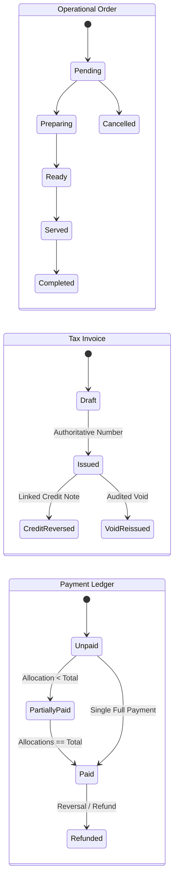
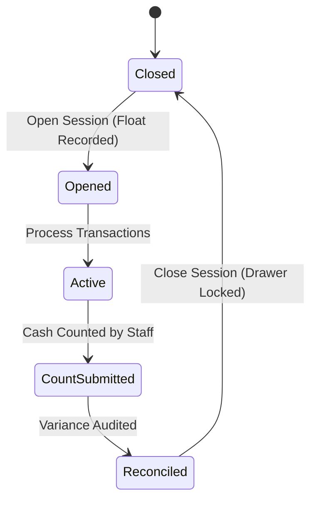

# Financial Contracts, Lifecycles, APIs & Schemas Specification

**Document:** `docs/finance-upgrade/CONTRACTS.md`  
**Date:** 2 November 2026  
**Status:** Canonical Implementation Contract for Phase 1+

---

## 1. Money & Tax Mathematical Contract

### 1.1 Integer Minor Units (INR Paise)
All stored, transferred, and calculated amounts in backend services MUST be non-negative integers representing paise (1 INR = 100 paise).
- `500.00` INR is stored as `50000`.
- `0.50` INR is stored as `50`.
- Zero floating-point accumulation in accounting ledgers.

### 1.2 Rounding Rules
- **Method:** Standard Half-Up rounding (`Math.round(val + 1e-9)`).
- **Line vs Invoice:**
  1. Line net amount: `lineGrossPaise - lineDiscountPaise`.
  2. Line taxes calculated per tax rule: `Math.round((lineNetPaise * taxRateBps) / 10000)` where `taxRateBps` is basis points (e.g., 2.5% = 250 bps).
  3. Invoice subtotal: sum of line net paise.
  4. Invoice tax total: sum of line tax paise.
  5. Invoice grand total: `subtotalPaise + taxPaise + serviceChargePaise + tipPaise`.

### 1.3 Residue Paise Allocation (Split Bills)
When a bill of total $T$ paise is split among $N$ payers:
- Base share: `base = Math.floor(T / N)`.
- Remainder paise: `rem = T % N`.
- The first `rem` payers pay `base + 1` paise; the remaining pay `base` paise.
- **Invariant:** $\sum \text{allocated} \equiv T$. Not a single paisa is created or lost.

---

## 2. Document & Operational Lifecycles



### Lifecycle Transition Rules:
1. An order can be updated while in `Draft` bill preview.
2. Once an invoice transitions to `Issued`, its snapshot (lines, prices, taxes, customer details) is permanently frozen. Later price changes in the menu do NOT alter issued invoices.
3. An issued invoice cannot be deleted. Any reduction in value requires an issued `Credit Note`.
4. Payment status is derived strictly from verified records in the `payments` collection allocated to that invoice.

---

## 3. Register Session & Cash Drawer Lifecycle



$$\text{Expected Cash} = \text{Opening Float} + \text{Cash Receipts} - \text{Cash Refunds} + \text{Cash In} - \text{Cash Out}$$
$$\text{Variance} = \text{Counted Cash} - \text{Expected Cash}$$

---

## 4. API & Idempotency Specifications

All financial mutation endpoints require:
- `Authorization: Bearer <JWT>`
- `X-Idempotency-Key: <UUID>`: Same key + same payload returns cached response. Same key + altered payload returns `409 Conflict`.

### Key Endpoints:
1. `POST /api/finance/invoices/issue`: Atomically freeze order lines, allocate sequential invoice number, persist invoice document.
2. `POST /api/finance/payments`: Record tender receipt (cash, UPI, card, debtor credit) and allocate to one or more invoices.
3. `POST /api/finance/credit-notes`: Issue a linked credit note against an issued invoice with manager authorization.
4. `POST /api/finance/sessions/open` & `POST /api/finance/sessions/close`: Register drawer shift open/close.

---

## 5. MongoDB Collection Schemas

### 5.1 `invoices`
```typescript
interface InvoiceDocument {
  _id: ObjectId;
  invoiceNumber: string; // "INV-20261102-0000001" (Unique Index)
  orderIds: ObjectId[];
  outletId: string;
  status: "draft" | "issued" | "cancelled";
  customerInfo: {
    name: string;
    phone?: string;
    room?: string;
    table?: string;
  };
  lines: Array<{
    itemId: ObjectId;
    name: string;
    quantity: number;
    unitPricePaise: number;
    discountPaise: number;
    netPaise: number;
    taxes: Array<{ name: string; rateBps: number; amountPaise: number }>;
    totalPaise: number;
  }>;
  subtotalPaise: number;
  taxTotalPaise: number;
  discountTotalPaise: number;
  grandTotalPaise: number;
  balanceDuePaise: number;
  paymentStatus: "unpaid" | "partially_paid" | "paid" | "refunded";
  issuedAt: Date;
  issuedBy: string; // Staff ID
  createdAt: Date;
  updatedAt: Date;
  version: number;
}
```

### 5.2 `payments`
```typescript
interface PaymentDocument {
  _id: ObjectId;
  receiptNumber: string; // "REC-20261102-0000001" (Unique Index)
  invoiceId: ObjectId;
  registerSessionId?: ObjectId;
  amountPaise: number;
  tender: "cash" | "upi" | "card" | "debtor" | "room_folio" | "complimentary";
  referenceNumber?: string; // UPI ref / Auth code
  tenderDetails?: {
    cashTenderedPaise?: number;
    changeGivenPaise?: number;
  };
  recordedBy: string;
  recordedAt: Date;
}
```

### 5.3 `credit_notes`
```typescript
interface CreditNoteDocument {
  _id: ObjectId;
  creditNoteNumber: string; // "CN-20261102-0000001" (Unique Index)
  invoiceId: ObjectId;
  reasonCode: "item_cancelled" | "overcharge" | "customer_dissatisfaction" | "pricing_error";
  reasonText: string;
  approvedBy: string; // Manager ID
  amountPaise: number;
  taxAdjustmentPaise: number;
  restockItems: boolean;
  issuedAt: Date;
}
```

### 5.4 `register_sessions`
```typescript
interface RegisterSessionDocument {
  _id: ObjectId;
  sessionNumber: string; // "REG-20261102-001"
  registerId: string;
  operatorId: string;
  openedAt: Date;
  closedAt?: Date;
  openingFloatPaise: number;
  cashReceiptsPaise: number;
  cashRefundsPaise: number;
  cashPaidInPaise: number;
  cashPaidOutPaise: number;
  expectedCashPaise: number;
  countedCashPaise?: number;
  variancePaise?: number;
  status: "open" | "closed";
}
```

---

## 6. Financial RBAC Permissions

| Permission Key | Description | Allowed Roles |
|---|---|---|
| `finance:view_invoices` | View billing list and invoice details | Cashier, Waiter, Manager, superadmin |
| `finance:issue_invoice` | Issue authoritative tax invoice | Cashier, Manager, superadmin |
| `finance:apply_discount` | Apply pre-issue line/order discount (< 10%) | Cashier, Manager, superadmin |
| `finance:approve_discount` | Approve discount >= 10% or custom amount | Manager, superadmin |
| `finance:issue_credit_note`| Issue credit note / post-issue refund | Manager, superadmin |
| `finance:manage_drawer` | Open/Close cash sessions and register drops | Cashier, Manager, superadmin |
| `finance:view_reports` | View aggregated financial summaries | Manager, superadmin |
| `finance:export_ledgers` | Export accountant-ready CSV/XLSX | Manager, superadmin |
